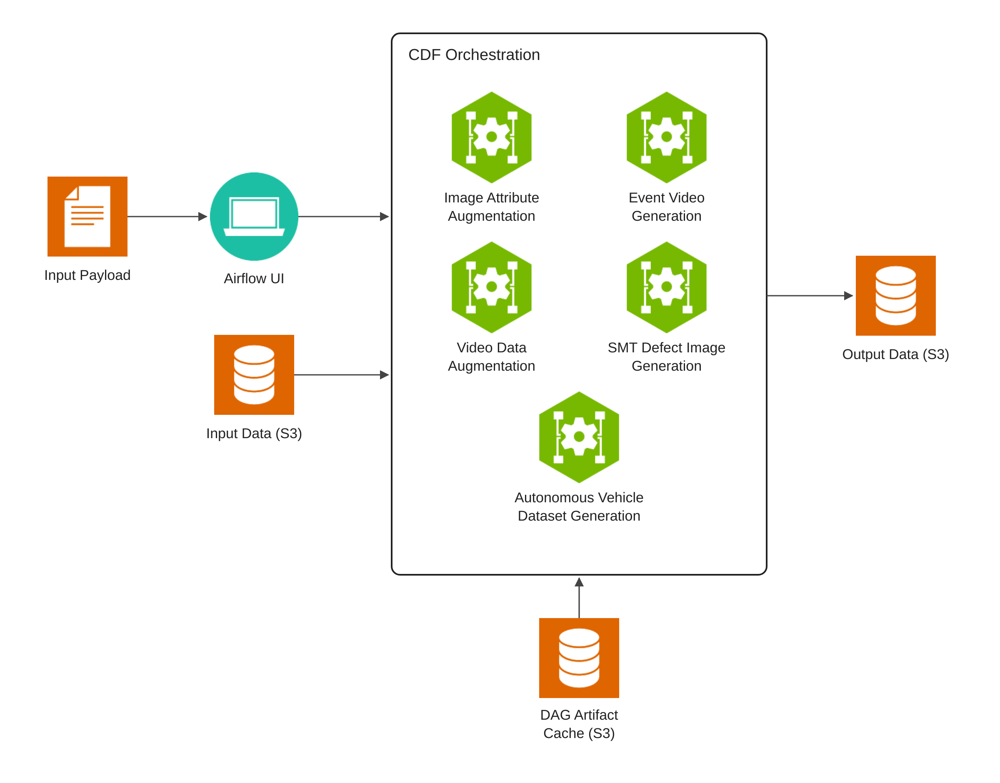

# CDF Orchestration

The Cosmos Data Factory (CDF) Orchestrator is an Airflow-based workflow orchestrator that runs on Kubernetes. It packages Directed Acyclic Graphs (DAGs) and plugins into the Airflow controller image that you build and deploy, and it can deploy GPU inference services and batch tasks in the cluster. Use it to run Synthetic Data Generation (SDG) workflows that create annotated video and image data for Cosmos model training or other physical AI use cases.

CDF Orchestration supports workflow orchestration on Kubernetes for every workflow, and on OSMO for the workflows that list it in the Platforms column below. OSMO runs use external model endpoints only.

## What Is Included

CDF Orchestration includes the following workflows. In Airflow they are DAGs.

| DAG | What It Does | Platforms |
|-----|--------------|-----------|
| **[Image Attribute Augmentation](docs/image-attribute-augmentation/getting-started.md)** | The Image Attribute Augmentation pipeline augments existing person object crop datasets by generating controlled variations of clothing, colors, footwear, and other visible person attributes. | Kubernetes |
| **[Event Video Generation](docs/event-video-generation/getting-started.md)** | The Event Video Generation pipeline takes a seed image and creates videos from it that show a controlled variation of event types, such as fires, falling, shoplifting, fighting, and more. | Kubernetes, OSMO |
| **[Video Data Augmentation](docs/video-data-augmentation/getting-started.md)** | Creates controlled Cosmos Transfer variants of source videos, then auto-labels the source and accepted generated videos into separate training exports. | Kubernetes, OSMO |
| **[SMT Defect Image Generation](docs/defect-image-generation/getting-started.md)** | Generates realistic clean and defective printed circuit board (PCB) component images through simulation, sim2real augmentation, and AnomalyGen. | Kubernetes |
| **[Autonomous Vehicle Dataset Generation](docs/autonomous-vehicle-dataset-generation/getting-started.md)** | Curates and retrieves driving-video clips, then optionally generates Cosmos3-Nano video variants using RGB input controls by default or optional pre-generated World Scenario Model (WSM) controls, with physical-plausibility evaluation. | Kubernetes |

## Architecture

## Getting Started

To get started with CDF Orchestration, refer to the [Getting Started Guide](docs/getting-started.md).

Refer to the `docs/` directory for additional documentation.

## License and Contributions

The CDF Orchestration is licensed under the Apache 2.0 license. This project is currently not accepting contributions; see [CONTRIBUTING.md](CONTRIBUTING.md).
