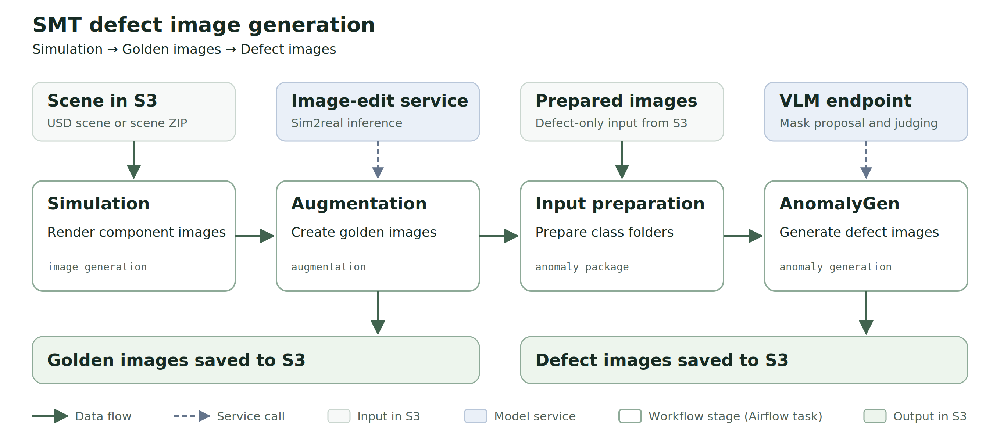

# Surface-Mount Technology (SMT) Defect Image Generation

Surface-mount technology (SMT) is a way of building printed circuit boards
(PCBs) in which components such as ICs and capacitors are soldered directly
onto the board's surface. Automated optical inspection (AOI) systems photograph
the assembled boards to catch defects such as solder bridges, excess solder or
missing components. Training and testing these inspection models requires many
examples of each defect, but real examples are scarce.

The SMT Defect Image Generation (DIG) workflow creates these examples
synthetically. Starting from a 3D scene of a PCB, it renders close-up images of
the components you select, uses an image-edit model to make them look like real
inspection-camera photos, and then uses AnomalyGen to add the defects you
request. A full run saves both sets of images: **golden images**, which show
each component without defects, and the **defect images** generated from them,
with manifests that trace every image back to its component on the board. You
can also run the stages separately, for example to create only golden images or
to add defects to clean images you already have.

## Contents

- [Architecture](#architecture)
  - [Simulate the Selected Components](#simulate-the-selected-components)
  - [Create Realistic Inspection Images](#create-realistic-inspection-images)
  - [Generate and Publish Defects](#generate-and-publish-defects)
- [Hardware Requirements](#hardware-requirements)
- [Running a Workflow](#running-a-workflow)
  - [Prepare the Payload](#prepare-the-payload)
  - [Check Service Access and Capacity](#check-service-access-and-capacity)
  - [Start the Workflow from the UI](#start-the-workflow-from-the-ui)
  - [Monitor the Run](#monitor-the-run)
- [Find the Results](#find-the-results)
- [Fine-Tuning (Optional)](#fine-tuning-optional)

## Architecture



### Simulate the Selected Components

The `image_generation` task runs CDF Simulation with the scene, component
selection and rendering settings from the payload. It renders a close-up image
of each selected component and records the component's type and reference
designator, such as `U1` or `C2`. These identities stay with each image through
the later stages, so you can trace any golden or defect image back to its
component on the board.

### Create Realistic Inspection Images

For each component image, the DAG starts a CPU task running CDF Augmentation.
That task sends the image and a configured prompt to an image-edit service,
which uses
[`nvidia/cdf-sim2real-smt-solderlight`](https://huggingface.co/nvidia/cdf-sim2real-smt-solderlight)
by default to give the render a realistic inspection-camera appearance.

The DAG saves these outputs as **golden images**: defect-free reference images,
one per component image, which become the clean inputs for defect generation.
If the DAG started the image-edit service, it shuts the service down after the
golden images are validated, freeing its GPUs for AnomalyGen.

### Generate and Publish Defects

AnomalyGen adds the requested defects to the golden images. It first asks a
vision-language model (VLM) to propose and judge where each defect can be
placed, then generates the defect with its fine-tuned model. The DAG then
checks the generated images and saves them to S3, with a manifest that links
each defect image to its golden image.

Each AnomalyGen defect applies to a class of component, such as `IC` or
`passive_component`. The payload maps each simulated component type to one of
these classes, and every type you render needs a mapping; refer to
[Map components to AnomalyGen classes](payload-guide.md#map-components-to-anomalygen-classes).
In defect-only mode, you supply clean images that are already sorted into these
classes.

## Hardware Requirements

Recommended GPU: NVIDIA RTX PRO 6000.

| Stage | GPUs |
| --- | --- |
| Simulation | 1 per golden configuration (1 in the sample payloads) |
| Image-edit | 1 per replica (the samples set 8) |
| AnomalyGen | 2 per defect configuration, on 1 node. Configurations run in parallel when GPUs are free, and one at a time otherwise. |
| **Minimum for a full run** | **2** on 1 node, since the stages run one after another |
| **Recommended** | **4**, since with fewer image-edit replicas, golden generation is slow |

All GPU tasks share one Airflow pool (`k8s_rtx6000_1`), sized to your cluster's GPU count. Work that doesn't fit waits its turn. To set the pool size, refer to [Check Service Access and Capacity](#check-service-access-and-capacity).

## Running a Workflow

Before you start, complete the shared
[Getting Started Guide](../getting-started.md) through opening the Airflow UI.

Each starter payload sets `pipeline_mode` to choose which stages run. For a
first end-to-end test, use the full workflow below.

| Pipeline mode | Runs | Starter payload |
| --- | --- | --- |
| full | Simulation → Golden images → Defect images | [Full workflow](../../payloads/dev/defect_image_generation_smt_dag/default_payload.json) |
| sim2real | Simulation → Golden images | [Golden images only](../../payloads/dev/defect_image_generation_smt_dag/golden_only_payload.json) |
| defect | Prepared clean images → Defect images | [Defect images only](../../payloads/dev/defect_image_generation_smt_dag/defect_only_payload.json) |
| simulation | Simulation only | Use the full workflow payload and set `pipeline_mode` to `simulation`. |

The full workflow sample uses the Artix PCB scene and selects **24 ICs and 14
capacitors**, producing **38 golden images**. It requests **3 defect
images**: 1 IC bridge, 1 passive-component excess solder and 1
passive-component missing. The number of defect images you request is
independent of the number of golden images; refer to
[defect counts](payload-guide.md#defects-and-output-counts) to change it.

### Prepare the Payload

Copy the starter payload for your mode, then update its input and output
locations.

1. **Prepare the input.** The sample payload is configured for the Artix PCB
   scene, `artix-dc-scm-v1.0.0.zip`. Download it from the
   [`nvidia/cdf-pcb-usd-dataset`](https://huggingface.co/datasets/nvidia/cdf-pcb-usd-dataset)
   dataset on Hugging Face. Simulation needs the scene's USD stage at the top
   level of the ZIP, and this ZIP keeps its files in an `artix-dc-scm/` folder,
   so repackage it without that folder:

   ```bash
   unzip artix-dc-scm-v1.0.0.zip
   (cd artix-dc-scm && zip -r ../artix-dc-scm-v1.0.0-flat.zip .)
   ```

   Upload `artix-dc-scm-v1.0.0-flat.zip` to your S3 bucket and set
   `input_scene` to its S3 path. The supplied simulation settings are an Artix
   preset, so when using another board, also update its scene paths and
   component selectors; refer to
   [Use another board](payload-guide.md#use-another-board).
   For defect-only mode, prepare clean component images instead; follow the
   [defect-only input instructions](payload-guide.md#defect-only-input).
2. **Set the output location.** Set `output_directory` to a writable S3 path,
   such as `s3://<your-bucket>/output/defect_image_generation_smt_dag`. Each run
   writes to its own subdirectory there, named after its Airflow run ID.
3. **Upload the AnomalyGen assets.** For full and defect-only runs, download
   the following from Hugging Face and upload them to your S3 bucket:
   - The recipe (`model/exp_texture_ft_pcb.yaml`) and checkpoint
     (`model/iter_000015000.pt`) from the
     [`nvidia/Cosmos-AnomalyGen-PCB-Nano`](https://huggingface.co/nvidia/Cosmos-AnomalyGen-PCB-Nano)
     model.
   - The shared assets from the
     [`nvidia/Cosmos-AnomalyGen-PCB-Dataset`](https://huggingface.co/datasets/nvidia/Cosmos-AnomalyGen-PCB-Dataset)
     dataset, without its `IC/clean_image/`, `IC/cad_mask/`,
     `passive_component/clean_image/` and `passive_component/cad_mask/`
     folders. Those folders hold the dataset's own sample boards and their CAD
     masks. AnomalyGen would otherwise use those boards as inputs alongside
     your images; in full mode, a defect generated on one of them fails the
     run's output validation.

   In the payload, set their S3 locations in `staging.fetch.recipe`,
   `staging.fetch.checkpoint` and `staging.fetch.input` under
   `defect_generation.defaults.anomaly_generation`. In defect-only mode,
   `staging.fetch.input` also lists your prepared images.

### Check Service Access and Capacity

- **Image-edit replicas.** The full and golden-only samples set
  `external_services: false`, so the DAG starts image-edit in the cluster. They
  request **8 replicas**, each using 1 GPU. Set
  `service_lifecycle.image_edit_service.replicas` to the number of GPUs
  available for image-edit; on a 4-GPU cluster, use `4` or less.
- **GPU pool.** Set `airflowPools.pools.k8s_rtx6000_1.slots` in
  `deploy/values.yaml` to the number of GPUs available for workflows, for
  example `4` for 4 GPUs. Simulation, the image-edit replicas and AnomalyGen
  all take GPUs from this pool, and each AnomalyGen job uses 2.
- **VLM endpoint.** For full and defect-only runs, use GPT-6 Astra. Replace the
  VLM placeholders in the full workflow and defect-only starter payloads with
  an endpoint that serves it; refer to
  [VLM settings](payload-guide.md#anomalygen-vlm) for the
  endpoint and model fields.
- **VLM API key.** Set the endpoint's key as `VLM_API_KEY` in `secrets.env`
  (refer to [Secrets](../getting-started.md#secrets)). If you add it after the
  initial setup, run `make setup` again to update the Helm secret values. If
  you leave it empty, AnomalyGen uses your NGC API key, which works only if your
  endpoint accepts it.
- **Apply the changes.** If you changed the pool size or secrets, run
  `make install sdg-controller` before starting the run. It reinstalls Airflow
  and deletes every pod in its namespace, so run it only when no workflows are
  running.

### Start the Workflow from the UI

1. Open
   [`defect_image_generation_smt_dag_k8s`](http://localhost:8080/dags/defect_image_generation_smt_dag_k8s)
   in Airflow and enable it if it is paused. The link uses the
   `make port-forward` address; if you open Airflow from another machine,
   replace `localhost` with the server's IP address.
2. Click the trigger button in the upper-right corner.
3. Under **Run Parameters**, replace `payload` with your prepared JSON.
4. Select **Trigger** to start the run.

To trigger, monitor, and stop the run without the UI, follow
[Run Workflows with the Airflow REST API](../airflow-rest-api.md) with
`DAG_ID=defect_image_generation_smt_dag_k8s`.

### Monitor the Run

Open the run's **Grid** or **Graph** view and follow `image_generation`,
`augmentation`, `anomaly_generation` and `validate_anomalygen_outputs`. A full
run finishes when the golden and defect outputs have been validated. Tasks
outside the selected mode are skipped.

Use the run ID shown in Airflow to locate the generated images in S3, as
described in [Find the results](#find-the-results).

To stop a run, open it in the **Grid** view, select the running task and mark
it as failed. The DAG then shuts down the image-edit service and cleans up the
run's Kubernetes resources. **Do not delete the run or the DAG** from the UI:
that skips the shutdown tasks and can leave GPU pods running. If any resources
remain, follow
[Stop a running workflow and clean up Kubernetes resources](../getting-started.md#stop-a-running-workflow-and-clean-up-kubernetes-resources).

## Find the Results

Each run saves its outputs under `<output_directory>/<run_id>/`, where
`<run_id>` is the Airflow run ID. The folder names inside come from the
payload's configuration IDs: `<golden_id>` is the `id` of a golden
configuration and `<defect_id>` is the `id` of a defect configuration. In the
full workflow sample, `<golden_id>` is `golden-mixed-components` and
`<defect_id>` is `ic-bridge`, `passive-excess-solder` or `passive-missing`.

A full run writes the following:

```text
<output_directory>/<run_id>/
  goldens/<golden_id>/
    simulation/                # CDF Simulation output, one folder per render pass
    augmentation/
      artifact/                # Golden images: image_000000.png, image_000001.png, ...
      manifest.json            # Simulation image and component for each golden image
  defects/<golden_id>/<defect_id>/
    artifact/                  # Validated defect images and their manifest.json
    anomaly_generation/        # Complete AnomalyGen output and export_manifest.json
    anomaly_package/artifact/  # Golden images sorted into AnomalyGen class folders
  reports/                     # Performance report, when enabled
```

To review the results, start with the validated defect images in
`defects/<golden_id>/<defect_id>/artifact/`. Each defect image keeps the
filename of the golden image it was generated from, so `artifact/image_000003.png`
is a defect version of `goldens/<golden_id>/augmentation/artifact/image_000003.png`.
The folder's `manifest.json` records these pairs, and the golden batch's
`augmentation/manifest.json` maps each golden image to its simulation image,
component type and reference designator.

The other folders hold intermediate outputs:

- `anomaly_generation/` contains everything AnomalyGen exported for the job,
  including images named by class and defect, such as `IC+bridge_00000.png`.
  Its `export_manifest.json` lists the input image for each export. In full
  mode, `artifact/` keeps at most one defect image per golden image, so look
  here to review every image AnomalyGen produced.
- `anomaly_package/artifact/` contains the golden images that the job passed to
  AnomalyGen, sorted into class folders such as `IC/clean_image/`.
- `simulation/` contains the CDF Simulation output, with one folder per render
  pass. Each pass folder's `dataset_index.json` lists its images.
- `augmentation/` also contains each image's augmentation config and metadata.
- `reports/` contains a YAML file of run statistics and an HTML dashboard when
  `enable_performance_reporting` is `true`, as in the starter payloads.

The other modes write part of this layout:

- **Golden images only** (`sim2real`) writes only `goldens/`.
- **Simulation only** (`simulation`) writes only `goldens/<golden_id>/simulation/`.
- **Defect images only** (`defect`) writes to `defects/<defect_id>/`, without
  the golden-ID level or `anomaly_package/`. Its `artifact/` folder keeps every
  exported image under its AnomalyGen filename.

To customize component selection, augmentation and defect settings, continue to
the [SMT Defect Image Generation Payload Guide](payload-guide.md).

## Fine-Tuning (Optional)

Use these recipes to adapt image appearance and defect generation to your
inspection data. Fine-tuning runs separately from the blueprint.

- **Sim2Real Qwen-Image-Edit:** Train a LoRA adapter on your own aligned
  simulation/target image pairs to adapt the appearance of SMT component crops.
  The [Sim2Real notebook](https://github.com/NVIDIA/cdf-simulation/tree/main/docs/tutorials/sim2real-qwen-image-edit)
  covers data preparation, training, comparison with the base model, and
  optional export of a merged pipeline.
- **AnomalyGen:** Fine-tune the defect generation model on your own defect
  images and masks. Follow the [AnomalyGen tutorial](https://github.com/NVIDIA/cdf-anomalygen#tutorial),
  including its [fine-tuning walkthrough](https://github.com/NVIDIA/cdf-anomalygen/blob/main/docs/tutorial/texture/4-fine-tuning.md),
  or use the [AnomalyGen skill](https://github.com/NVIDIA/cdf-anomalygen/blob/main/skills/cdf-anomalygen/SKILL.md)
  for an agent-guided workflow.

Review the generated images for geometry and defect preservation before using
existing inspection labels. To connect a compatible image-edit service for
Sim2Real, follow the [image-edit service settings](payload-guide.md#image-edit-service).
For AnomalyGen, supply the matching recipe, checkpoint, and shared assets
described in [Defects and Output Counts](payload-guide.md#defects-and-output-counts).
